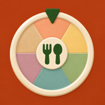
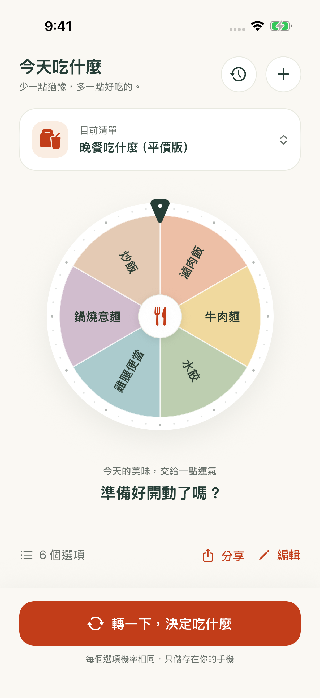
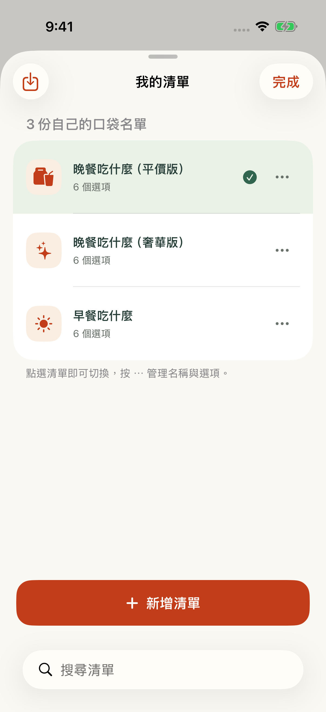
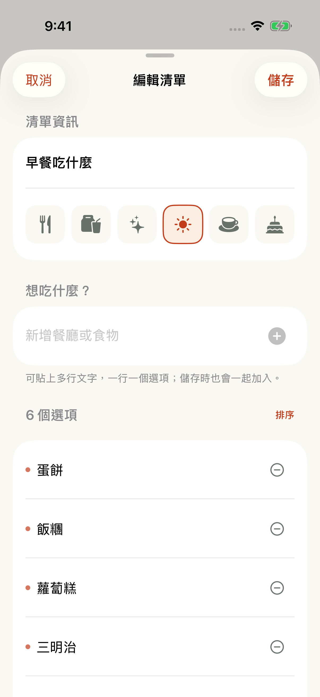
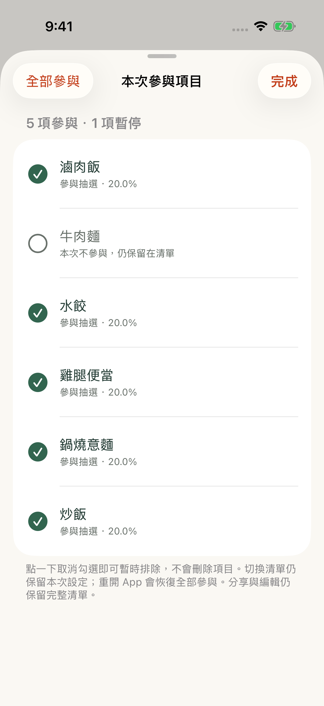
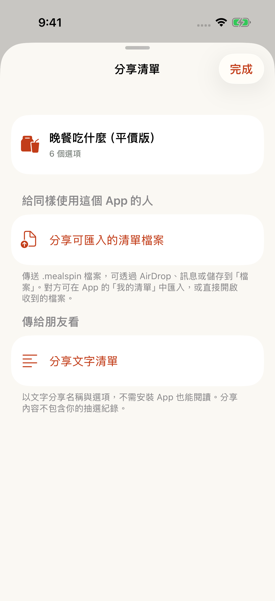

  

# 今天吃什麼 · MealSpin

**少一點猶豫，多一點好吃的。**

午餐時間到了，卻還在問「要吃什麼？」把愛吃的餐廳和料理放進 MealSpin，轉一下，讓下一餐有個答案。

不用註冊、沒有廣告，也沒有訂閱。打開就能選，沒網路也能用。

[看看怎麼用](#三步驟決定下一餐) · [下載與安裝](#下載並安裝到自己的手機) · [常見問題](#常見問題)

## 先看看 MealSpin

  
  
  

從左到右：**轉盤首頁 → 我的清單 → 編輯口袋名單**。以上為 iPhone 模擬器的實際畫面。

## 把「都可以」變成「就吃這個」

- **打開就有靈感。** 內建早餐、平價晚餐、奢華晚餐三份清單，第一次使用也能直接轉。
- **裝進你的口袋名單。** 依照預算、地點或心情建立清單；巷口便當、週五燒肉、下午茶甜點，都可以放進來。
- **今天不想吃，先暫停。** 取消勾選就能暫時排除，想吃時再加回來，不必刪掉選項。
- **好吃的，一起分享。** 傳文字給朋友參考，或分享清單檔案，讓同樣使用 MealSpin 的朋友加入自己的轉盤。
- **回頭看看轉過什麼。** 自動保留最近 100 次抽選結果，不用另外記下來。

也支援深色模式、放大文字與 VoiceOver 結果朗讀，依照你習慣的方式使用。

## 三步驟，決定下一餐

1. **挑一份清單。** 點首頁上方的「目前清單」卡片，選早餐或晚餐；也可以先用預設的平價晚餐清單。
2. **轉一下。** 點底部「轉一下，決定吃什麼」，等轉盤停下來。
3. **看看今天吃什麼。** 結果會出現在轉盤下方。還想看看其他選擇？點「再轉一次」。

每個參與抽選的選項機率相同，結果也會自動加入右上角時鐘圖示的「抽選紀錄」。

### 換成你愛吃的

點首頁「編輯」修改目前清單，或點右上角 **＋** 建立新清單。取個名字、挑個圖示，在「新增餐廳或食物」填入選項，最後點「儲存」。

已經有一長串口袋名單？直接貼上文字，**一行一個選項**，不用逐項輸入。

### 今天先不吃某幾樣

點轉盤下方的「6 個選項」（數字會依清單改變），取消勾選今天不想吃的項目，再點「完成」。

暫停的食物仍會留在清單裡。這次開啟 App 期間會保留設定；完全關閉後重新開啟，會恢復全部參與，也能隨時點「全部參與」恢復。

### 把清單傳給朋友

點首頁「分享」，依照對方的需要選擇：

- **只想傳口袋名單：** 選「分享文字清單」，朋友不用安裝 App 也能閱讀。
- **想讓朋友也能轉：** 選「分享可匯入的清單檔案」，傳送 `.mealspin` 檔案。朋友安裝 MealSpin 後，開啟收到的檔案，或從「我的清單」→「匯入清單」選取，再點「加入我的清單」。

匯入前可以先預覽；即使清單同名，也會新增一份副本。分享內容不包含抽選紀錄。

  
  

### 資料無法讀取時

首頁會保留「資料需要回復」入口，這時新增、匯入及修改都不會覆寫原始資料。先試「重新讀取資料」。若仍失敗，選「保留原始資料副本」並匯出到安全的位置。

確定要重新開始時，選「保留副本並重建資料」並確認。App 會先保留原檔，再建立範例清單；備份或儲存失敗時不會解除保護。重建後或重開 App，仍可從首頁的「原始資料副本」匯出副本。這些原始副本可能需要修復，不能直接當作 `.mealspin` 清單匯入。刪除 App 也會移除 App 內的副本，請另存到安全的位置。

## 下載並安裝到自己的手機

**目前這裡提供的是原始碼下載，需要用 Mac 上的 Xcode 協助安裝到 iPhone 或 iPad。ZIP 不能直接在手機上安裝。**

開始前，請準備：

- 一台 Mac，並安裝可支援你手機系統版本的 [Xcode](https://apps.apple.com/tw/app/xcode/id497799835)。
- iOS 17／iPadOS 17 或更新版本的 iPhone／iPad，以及可傳輸資料的連接線。
- 你的 Apple 帳號，用於將 App 安裝到自己的裝置；免費帳號即可。

**使用免費帳號安裝，每 7 天需要接回 Mac，從 Xcode 再執行一次。** 這是 Apple 個人安裝的期限，詳見 [Apple 官方說明](https://developer.apple.com/help/account/basics/about-your-developer-account)。

### 安裝流程

1. **下載並解壓縮。** [下載 MealSpin 原始碼 ZIP](https://github.com/Vickyciou/MealSpin/archive/refs/heads/main.zip)，在 Mac 上解壓縮後，雙擊 `MealSpin.xcodeproj`。
2. **登入 Apple 帳號。** 在 Xcode 選單開啟 **Xcode → Settings → Apple Accounts**（部分版本為 **Accounts**），加入你的帳號。
3. **連接手機。** 用連接線接上 Mac，解鎖手機，依提示選擇「信任這部電腦」。若 Xcode 要求開啟開發者模式，依手機「設定 → 隱私權與安全性 → 開發者模式」的指示啟用並重新啟動。
4. **選擇自己的簽署帳號。** 點 Xcode 左側藍色 MealSpin 專案圖示 → **TARGETS → MealSpin → Signing & Capabilities**，勾選 **Automatically manage signing**，在 **Team** 選擇自己的帳號（免費帳號會顯示 **Personal Team**）。若提示識別碼已被使用，把 **Bundle Identifier** 改成自己的唯一名稱，例如 `com.yourname.mealspin`，並把 `yourname` 換成自己的英文字母名字或其他不重複字串。
5. **安裝到你的手機。** 在 Xcode 上方選擇 **MealSpin** 與你的實體 iPhone／iPad 名稱，按 **▶ Run**，等待安裝與啟動完成。
6. **開始轉。** 手機出現「今天吃什麼」後，就可以拔掉連接線，隨時決定下一餐。

第一次接觸 Xcode，或遇到信任、簽署、找不到手機等問題？跟著 [完整安裝教學](docs/INSTALL.md) 操作。

## 常見問題

**只有 iPhone，沒有 Mac，可以安裝嗎？**

這份原始碼版本需要透過 Mac 的 Xcode 安裝，目前此頁沒有 App Store 或 TestFlight 安裝入口。只有手機或 Windows 電腦，無法依照上述方式安裝；Android 目前也不支援。

**需要付費或登入嗎？**

MealSpin 沒有廣告、訂閱或付費功能，也不需要 App 帳號。安裝時用到的 Apple 帳號，是 Xcode 安裝到自己手機所需。

**沒網路也能用嗎？會幫我找附近餐廳嗎？**

建立清單、轉盤與查看紀錄都能離線使用。MealSpin 會從你放進清單的選項中抽選，目前沒有附近餐廳搜尋、地圖或訂餐功能。

**換手機或刪除 App，清單還在嗎？**

清單與紀錄保存在裝置內，MealSpin 沒有提供雲端同步。刪除 App 會一併移除這些資料；換手機或刪除前，建議先把想保留的清單分享成 `.mealspin` 檔案，存到「檔案」中的 iCloud Drive 或另一個安全位置。清單檔案不包含抽選紀錄。

**安裝幾天後打不開了？**

若使用免費 Apple 帳號安裝，可能是 7 天的簽署期限已到。把手機接回原本的 Mac，使用同一個專案、Apple 帳號與 Bundle Identifier，再按一次 **▶ Run**。請先保留手機上的 App，避免刪除時一併移除清單。

---

想回報問題或提出願望？歡迎到 [Issues](https://github.com/Vickyciou/MealSpin/issues) 留言。想了解程式與測試方式，請看 [開發說明](docs/DEVELOPMENT.md)。本專案採用 [MIT License](LICENSE)。
