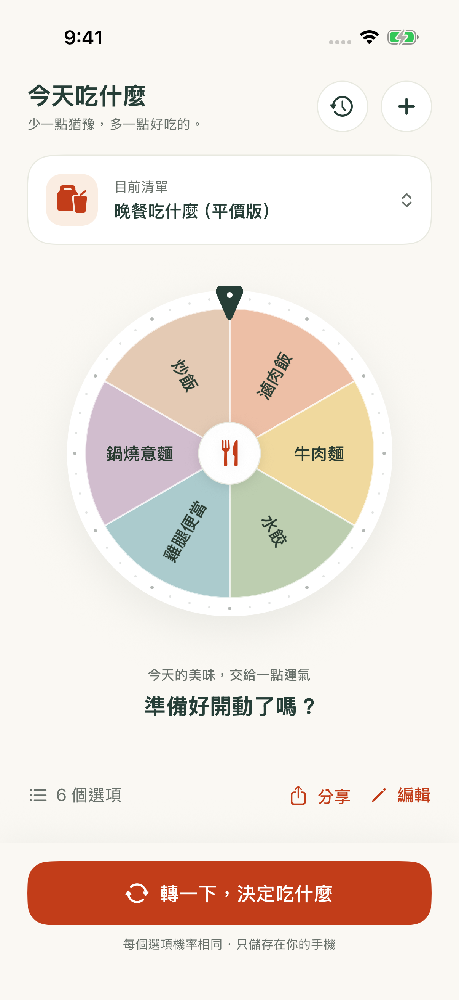

# 把 MealSpin 安裝到自己的 iPhone／iPad

這份教學適合第一次用 Xcode 安裝 App 的人，不需要修改 App 程式碼。你會在 Mac 上下載 MealSpin，再由 Xcode 將它安裝到自己的手機。

[回到 MealSpin 介紹](../README.md) · [專案總覽](overview.md) · [開發說明](DEVELOPMENT.md)

## 開始前，先確認這幾件事

| 你需要的東西 | 用途 |
| --- | --- |
| 一台 Mac | 執行 Xcode；這個安裝方式不適用於 Windows 或只用手機的情況 |
| [Xcode](https://apps.apple.com/tw/app/xcode/id497799835) | 從 Mac App Store 免費下載；版本必須同時支援你的 macOS 與手機系統 |
| iPhone 或 iPad | iOS 17／iPadOS 17 或更新版本 |
| 可傳輸資料的連接線 | 將手機接上 Mac，第一次安裝建議使用有線連接 |
| Apple 帳號與網路連線 | 讓 Xcode 處理安裝所需的簽署；免費帳號即可 |

**免費帳號的安裝有效期為 7 天。** 到期後需接回 Mac，再由 Xcode 執行一次；不需要為了個人試用先購買開發者會員。Apple 也限制免費帳號同一裝置同時安裝的 App 數量，詳見 [Apple 的 Personal Team 說明](https://developer.apple.com/help/account/basics/about-your-developer-account)。

## 1. 下載 MealSpin

在 **Mac** 上點選 [下載 ZIP](https://github.com/Vickyciou/MealSpin/archive/refs/heads/main.zip)，下載後雙擊解壓縮。

也可以開啟 [MealSpin GitHub 頁面](https://github.com/Vickyciou/MealSpin)，點綠色 **Code → Download ZIP**。

打開解壓縮後的 `MealSpin-main` 資料夾，雙擊 **`MealSpin.xcodeproj`**，用 Xcode 開啟。

如果這是第一次啟動 Xcode，依畫面同意條款並完成必要元件與 iOS 平台支援的安裝，再繼續操作。下載 ZIP 是取得專案檔案，還不會把 App 安裝進手機。

## 2. 在 Xcode 登入 Apple 帳號

從 Mac 上方選單打開 **Xcode → Settings… → Apple Accounts**。部分 Xcode 版本的頁籤名稱為 **Accounts**。

點 **＋** 或 **Add Apple Account**，登入自己的 Apple 帳號，依提示完成雙重認證。免費帳號登入後，會有 **Personal Team** 可供選擇。

帳號只需在 Xcode／Apple 的登入畫面輸入。MealSpin App 本身不需要註冊或登入。此步驟可參考 [Apple 的裝置執行教學](https://developer.apple.com/documentation/xcode/running-your-app-on-simulated-or-physical-devices)。

## 3. 連接並準備手機

1. 用連接線把 iPhone／iPad 接上 Mac，並解鎖裝置。
2. 若手機詢問「要信任這部電腦嗎？」，點「信任」並輸入手機密碼；Mac 若詢問是否允許配件連接，也依提示允許。
3. 在 Xcode 上方的執行裝置選單中選擇自己的手機。第一次連接可能需要等待配對與裝置準備完成。
4. 若要求開啟開發者模式，在手機前往 **設定 → 隱私權與安全性 → 開發者模式**，開啟後依提示重新啟動。重開後解鎖手機，確認「開啟」並輸入密碼。

找不到「開發者模式」時，先確認手機已與 Xcode 配對，再檢查設定。這個模式是使用 Xcode 安裝與執行 App 所需，相關步驟見 [Apple 的開發者模式說明](https://developer.apple.com/documentation/xcode/enabling-developer-mode-on-a-device)。

## 4. 告訴 Xcode：安裝到我自己的裝置

依照以下位置操作：

1. 點 Xcode 左側檔案列表最上方的 **MealSpin 藍色專案圖示**。若看不到左側列表，按 **⌘1**。
2. 中間設定區找到 **TARGETS**，選 **MealSpin**。請選 App 本身，而不是 `MealSpinUITests`。
3. 開啟上方 **Signing & Capabilities** 頁籤。
4. 勾選 **Automatically manage signing**。
5. 在 **Team** 選擇自己的帳號；免費帳號後面會顯示 **(Personal Team)**。
6. 若 **Bundle Identifier** 顯示已被使用，改成自己的唯一名稱，例如 `com.vickychen.mealspin`。請把 `vickychen` 換成自己的英文字母名字或其他不重複字串。

Bundle Identifier 是手機識別 App 的名字。選好之後請保留，日後重新安裝使用同一個值即可。

等待 Xcode 處理簽署。如果出現要求登入、接受協議或 **Try Again** 的提示，依畫面完成。以上設定對應 [Apple 的自動簽署流程](https://help.apple.com/xcode/mac/current/en.lproj/dev60b6fbbc7.html)。

## 5. 按下 Run，安裝到手機

在 Xcode 上方確認：

- 執行項目是 **MealSpin**。
- 執行裝置是**你自己的 iPhone／iPad 名稱**，不是 iPhone 模擬器，也不是 **Any iOS Device**。

點左上角 **▶ Run**，或按 **⌘R**。保持手機解鎖，等待 Xcode 完成安裝；第一次可能需要較久。

如果手機或 Xcode 要求確認允許執行，依提示完成後再按一次 Run。若顯示「未受信任的開發者」，可在手機 **設定 → 一般 → VPN 與裝置管理** 找到自己帳號對應的開發者項目，完成信任後再試；只有系統出現相關提示時才需要此步驟。

手機自動打開「今天吃什麼」，或主畫面上出現 App 圖示，就表示安裝完成。

## 6. 選好清單，轉一下

先用預設的「晚餐吃什麼（平價版）」，點底部 **「轉一下，決定吃什麼」** 試試看。

之後可以拔掉連接線，直接從手機主畫面開啟 App。日常建立清單、抽選與查看紀錄都能離線使用。

  

## 安裝遇到問題時

| 遇到的狀況 | 可以先試試 |
| --- | --- |
| Xcode 沒有顯示手機 | 確認連接線可傳資料、手機已解鎖並信任 Mac，等待配對完成；必要時重新插拔 |
| 提示手機系統不受支援 | 更新到支援該 iOS／iPadOS 版本的 Xcode；也可能需要先更新 Mac 的 macOS |
| 找不到 Team，或顯示需要開發團隊 | 確認已在 Xcode 的 Apple Accounts／Accounts 登入，再回到 MealSpin 的 Signing & Capabilities 選擇帳號 |
| 提示 Bundle Identifier 已被使用 | 把識別碼改成含有自己名字或其他不重複字串的名稱 |
| 提示 Developer Mode disabled | 依第 3 步開啟手機的開發者模式，重新啟動並在手機上確認 |
| 免費帳號達到安裝數量上限 | Apple 限制免費帳號每台裝置最多安裝 3 個這類 App；先確認是否已有其他個人簽署的 App |
| 幾天後 App 打不開 | 免費帳號的簽署可能已到期，按下方方式重新執行 |

### 免費帳號到期後，怎麼繼續使用？

把手機接回 Mac，打開原本的 MealSpin 專案，選擇同一個 Apple 帳號、同一個 Bundle Identifier 與同一台手機，再按 **▶ Run**。

請先保留手機上的 App。**刪除 App 會一併移除本機清單與紀錄**；日常也可以把重要清單匯出成 `.mealspin` 檔案，存到 iCloud Drive 或其他安全位置。匯出的清單不包含抽選紀錄。

### 清單資料需要回復時

若 App 已能啟動，但首頁顯示「資料需要回復」，先按「重新讀取資料」。仍無法讀取時，按「保留原始資料副本」，再按「匯出原始資料副本」，存到 iCloud Drive 或另一個安全位置。

只有確定要以範例清單重新開始時，才選「保留副本並重建資料」並確認。App 會在副本成功保存後才重建，失敗時維持保護狀態。重建與重新啟動後，仍可從首頁的「原始資料副本」匯出。這是原始資料檔案，可能需要修復，並非可直接匯入的 `.mealspin` 清單。刪除 App 會連同這些副本一起移除，先將副本另存。

如果仍無法安裝，歡迎到 [Issues](https://github.com/Vickyciou/MealSpin/issues) 附上 Xcode 錯誤訊息，以及 macOS、Xcode、iOS／iPadOS 版本；請遮住帳號等個人資訊。
