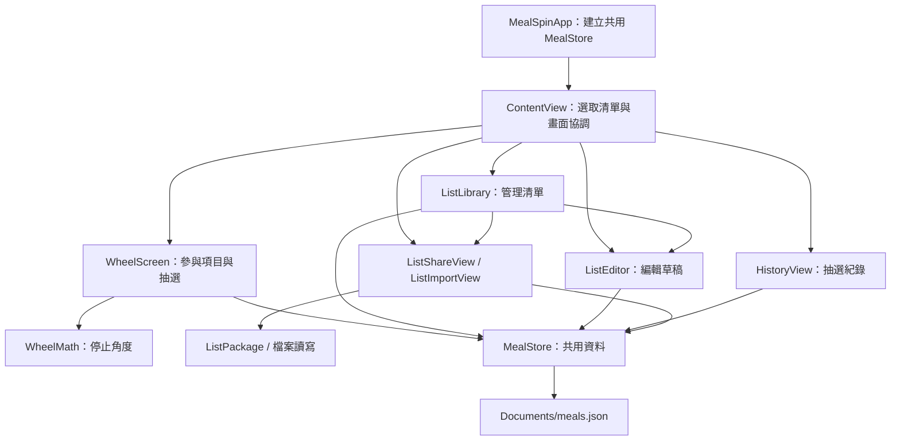

# MealSpin 架構與整合契約

本文件記錄目前實作的狀態歸屬、資料生命週期與跨畫面／檔案契約，作為修改行為時的核對依據。

[專案總覽](overview.md) · [模組責任](modules.md) · [開發說明](DEVELOPMENT.md)

## 結構與依賴

App 使用 SwiftUI 畫面與共用的 `MealStore`。目前功能都編譯於同一個 App target；以下是檔案間的邏輯分工。



`MealSpinApp` 以 `@State` 持有 `@MainActor @Observable MealStore`，再將同一個實例傳入各畫面。`ContentView` 用 `HomeSheet` 決定首頁的 sheet，`ListLibrary` 另外管理從清單庫開啟的編輯、分享與匯入畫面。

## 狀態與儲存

| 資料 | 擁有者／保存位置 | 生命週期與契約 |
| --- | --- | --- |
| 清單與抽選紀錄 | `MealStore`；`SavedMeals` 編碼至 `Documents/meals.json` | 重新啟動後讀回；App 沒有提供雲端同步 |
| 最近選取的清單 | `ContentView` 的 `@AppStorage("selectedFoodList")` | 保存清單 UUID 字串；無對應清單時，畫面使用第一份清單 |
| 暫停參與的項目 | `MealStore.temporaryExclusions` | 依清單 UUID 保存食物名稱集合，只在目前程序記憶體存在；切換清單及再次抽選會保留，重新啟動後清除 |
| 編輯草稿 | `ListEditor` 的區域狀態 | 儲存成功才更新 store；放棄修改不寫入 |
| 轉盤角度與目前結果 | `WheelScreen` 的區域狀態 | 參與項目改變時清除角度與目前結果；歷史紀錄另外由 store 保存 |
| 待預覽的外部清單 | `ContentView.pendingImport` | 單一暫存值，首頁沒有 sheet 且未抽選時才呈現預覽 |

本機檔案尚不存在時，`MealStore` 建立並儲存三份範例清單。已有檔案卻解碼失敗時，初始化會提供錯誤訊息，保留原始檔案，不自動重設為範例清單；這並非後續寫入的唯讀保護。

`commit(lists:history:)` 先以 `.atomic` 寫入，再更新記憶體中的清單與紀錄。寫入失敗會回報 `errorMessage`，保留既有的清單與紀錄狀態。成功更新後，會移除已不存在清單或食物所對應的暫停設定。

`record(food:list:)` 將新紀錄放在最前面，最多保留 100 筆。紀錄保存當時的清單名稱與食物文字，因此改名或刪除清單不會改寫既有紀錄；`clearHistory()` 只清除紀錄。刪除 App 會移除本機資料；清單的備份與還原操作見 [安裝教學](INSTALL.md#免費帳號到期後怎麼繼續使用)。

## 清單編輯與抽選

`ListEditor` 在草稿中新增、刪除及排序選項，儲存前整理首尾空白、空選項與重複名稱。名稱不可空白，清單本身可以沒有選項。本機編輯未套用分享檔案的名稱長度與項目數限制；超過分享限制時，檔案分享按鈕會停用並顯示原因，文字分享仍可使用。

抽選流程如下：

1. `MealStore.participatingItems(in:)` 從完整清單扣除本次暫停項目。
2. `WheelScreen.spin()` 對參與陣列的索引等機率抽選。
3. `WheelMath.targetRotation` 依索引與目前角度計算停止位置，讓十二點鐘方向的指針對齊結果扇區。
4. 動畫完成且畫面仍有效時，顯示結果、呼叫 `store.record`，並發出觸覺回饋與 VoiceOver 朗讀。

空清單的主按鈕會開啟編輯；有選項但全部暫停時，主按鈕會開啟參與項目面板。抽選期間會停用清單切換、編輯、分享與參與設定。

**參與項目超過 16 個時，`WheelDisc` 隱藏扇區文字。** 項目仍參與抽選，完整名稱可在參與項目面板查看。參與設定只影響候選陣列，編輯、文字分享與檔案分享都使用完整清單。

## 分享檔案契約

`ListPackage` 是單份清單的 JSON 格式，與含有本機 UUID、紀錄的 `SavedMeals` 格式分開。範例：

```json
{
  "format": "mealspin-list",
  "version": 1,
  "name": "早餐吃什麼",
  "symbol": "sun.max.fill",
  "items": ["蛋餅", "飯糰"]
}
```

| 欄位／限制 | 契約 |
| --- | --- |
| `format` | 必要字串，固定為 `mealspin-list` |
| `version` | 必要整數，目前只接受 `1` |
| `name` | 必要字串；整理首尾空白後不可為空，最多 120 個 Swift `Character` |
| `symbol` | 必要字串；支援的圖示由 `ListPackage.makeList()` 定義，未知值在解碼建立清單時改為 `fork.knife` |
| `items` | 必要字串陣列；最多 500 項，每項最多 200 個 Swift `Character`；可為空陣列 |
| 檔案大小 | 編碼與解碼皆接受最多 1,048,576 bytes 的 JSON 資料 |
| 隱私與識別 | 分享內容不包含本機清單 UUID、抽選紀錄或暫停設定；每次解碼建立新 UUID |

項目數與每項長度先驗證，再整理首尾空白、空選項與重複項目；例如 501 個相同選項仍會被拒絕。`encode` 與 `decode` 都驗證契約；`encode` 寫出原清單欄位，`decode` 建立整理後的新清單。

## 系統檔案整合與匯入

| 項目 | 註冊值／入口 |
| --- | --- |
| 副檔名 | `.mealspin` |
| 自訂 UTType | `com.personal.mealspin.list`，符合 `public.json` |
| MIME type | `application/vnd.mealspin.list+json` |
| 程式宣告 | `ListSharing.swift` 的 `UTType.mealSpinList` |
| 系統宣告 | `Info.plist` 的 `UTExportedTypeDeclarations` 與 `CFBundleDocumentTypes` |
| App 內匯入 | `ListLibrary.fileImporter`，每次選擇一個檔案 |
| 外部開啟 | `ContentView.onOpenURL` |

兩個匯入入口都透過 `ListFileReader.read` 讀取本機檔案 URL，處理 security-scoped resource 存取與 `NSFileCoordinator` 協調，在背景工作中限制讀取量並解碼，再由 `ListImportView` 預覽。

收到外部檔案時，`ContentView` 會在首頁 sheet 關閉及抽選結束後嘗試顯示預覽。待處理資料是單一值；此處沒有多檔匯入佇列。從清單庫的檔案選擇器匯入則在清單庫內顯示預覽。

按「加入我的清單」且 store 儲存成功才完成匯入；取消不寫入。同名清單因 UUID 不同而新增為獨立副本。`ListFileExporter` 將分享檔案寫入暫存目錄，再交給 `UIActivityViewController`；文字分享只包含清單名稱與選項。

## 實作與驗證依據

- [MealSpinApp.swift](../MealSpin/MealSpinApp.swift)：store 生命週期與測試資料入口。
- [ContentView.swift](../MealSpin/ContentView.swift)、[ListLibrary.swift](../MealSpin/ListLibrary.swift)：畫面協調與匯入入口。
- [Models.swift](../MealSpin/Models.swift)：資料保存、抽選幾何與分享格式。
- [WheelView.swift](../MealSpin/WheelView.swift)、[ListEditor.swift](../MealSpin/ListEditor.swift)、[HistoryView.swift](../MealSpin/HistoryView.swift)：抽選與編輯／紀錄行為。
- [ListSharing.swift](../MealSpin/ListSharing.swift)、[Info.plist](../MealSpin/Info.plist)：檔案讀寫與系統型別註冊。
- [ModelChecks.swift](../Tests/ModelChecks.swift)、[FlowTests.swift](../Tests/FlowTests.swift)：資料契約與操作流程檢查；執行方式及實機驗證範圍見 [開發說明](DEVELOPMENT.md)。
